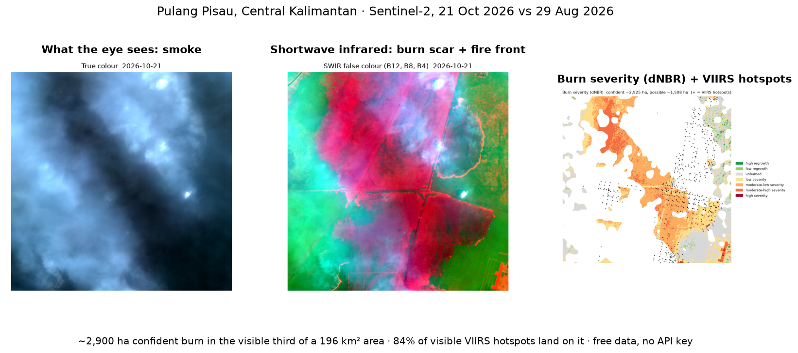
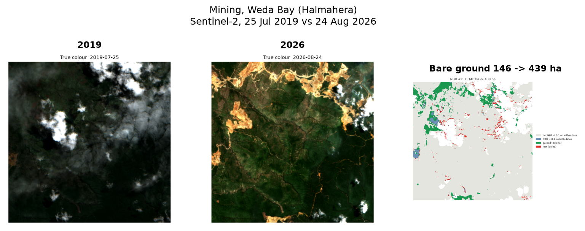

# open-satellite-analysis

A skill you attach to an agent so it can query and analyse a case on a map, from free public satellite data (the same pattern as [pid-parser](https://github.com/dzakybd/pid-parser)). Give an address or coordinates and a question ("how much burned here this fire season?", "did this area flood last week?"). The skill finds the clearest scene over that exact area from Sentinel-2, Landsat 8/9 or Sentinel-1 radar, computes a published spectral index from the [Awesome Spectral Indices](https://github.com/awesome-spectral-indices/awesome-spectral-indices) catalog with [spyndex](https://github.com/awesome-spectral-indices/spyndex), compares dates, and checks fires against NASA FIRMS hotspots. No account and no API key. The approach is published index formulas, cloud masks and plain thresholds, so every number can be reproduced.



Two versions, like [pid-parser](https://github.com/dzakybd/pid-parser):

1. **A skill for coding agents** (Claude Code, Codex and others that load `SKILL.md` skills): `npx skills add dzakybd/open-satellite-analysis`
2. **A LangChain Deep Agents version** you can run in your own agent workflow (`agent/run.py`)

See all five cases, no install needed: [huggingface.co/spaces/dzakybd/open-satellite-analysis](https://huggingface.co/spaces/dzakybd/open-satellite-analysis). The write-up, step by step: [dzaky.ai.id/en/blog/open-satellite-analysis](https://dzaky.ai.id/en/blog/open-satellite-analysis).

## Five cases, each checked against news and reports

| Question | Place and dates | Data and index | Result |
|---|---|---|---|
| How much burned? | Pulang Pisau, Central Kalimantan, 29 Aug vs 21 Oct 2026 | Sentinel-2, NBR (dNBR) | ~2,925 ha confident burn in the 33.9% visible through smoke; 83.6% of 318 visible VIIRS hotspots on it |
| The same fire, a second satellite | 25 Aug vs 4 Oct 2026 | Landsat 8/9, dNBR | ~4,003 ha, whole area visible |
| How far did the mine spread? | Weda Bay, Central Halmahera, Jul 2019 vs Aug 2026 | Sentinel-2, NBR < 0.1 | bare ground 146 → 439 ha |
| How much was cleared for a capital? | IKN core area, Sepaku, Jun 2021 vs Sep 2026 | Sentinel-2, NBR > 0.3 | ~1,611 ha of standing vegetation lost (mostly plantation) |
| How much water is in the lake? | Danau Sentarum, West Kalimantan, 11 May vs 7 Aug 2026 | Landsat 8/9, MNDWI > 0 | ~12,639 → ~155 ha |
| Where did the flood go? | Demak, Central Java, 27 Jan vs 8 Feb 2024 | Sentinel-1 radar, VV < -15 dB | ~1,003 ha of new open water (1,281 ha on the other orbit), a lower bound |

The independent sources for each place and date are in [docs/references.md](docs/references.md), each marked as read or not. Where the scope differs (a regency-wide figure against a 14 km box, concession-wide against an 8 km box), the page says so, and the post treats the match as order of magnitude and direction, not exact.



## What it adds over a STAC search

Open MCP servers for STAC already search and download scenes. This skill covers the steps after the download, where agents tend to go wrong:

- **Cloud judged over your area, not the tile.** It reads the cloud mask for the AOI only. In the Pulang Pisau run, a scene listed at 13.6% cloud had 66% of the AOI under smoke.
- **The right bands for the question.** The catalog maps each index to its bands; `search_index.py` lists only indices the sensor can compute and warns that catalog `S2` means SWIR 2, not Sentinel-2.
- **Correct reflectance.** Earth Search pixels are already corrected for the 2022 ESA offset (`earthsearch:boa_offset_applied`) while the metadata still lists it. Applying it again pushes SWIR negative and turns forest NDVI into -0.99.
- **Pictures that see through smoke.** Every optical scene also gets a SWIR false-colour image, where burn scars and fire fronts show through smoke.
- **An independent check.** `compare.py --burn --hotspots` reports how many VIIRS fire detections land on the burn map.
- **A second sensor when the first is blind.** Landsat on other days, and Sentinel-1 radar for floods under cloud, with the same-orbit rule for radar change.
- **Haze guidance.** Thin haze is not masked and skews vegetation indices (it made vegetation look like it grew around a nickel mine). The skill tells the agent to measure what appears (bare ground) instead of what disappears.

## Data sources

| Source | Resolution / revisit | Access | Flag |
|---|---|---|---|
| Sentinel-2 L2A | 10-20 m, ~5 days | Earth Search (AWS), no key | default |
| Landsat 8/9 C2 L2 | 30 m, ~8 days with both | Planetary Computer, anonymous token | `--source landsat` |
| Sentinel-1 RTC (radar) | 10 m, ~6-12 days, sees through cloud and smoke | Planetary Computer, anonymous token | `--source sentinel-1 --relative-orbit N` |
| FIRMS VIIRS (S-NPP, NOAA-20, NOAA-21), MODIS | 375 m / 1 km, several passes a day | public 24 h / 48 h / 7 d files | `hotspots.py` |
| Copernicus DEM | 30 m elevation | Earth Search, no key | suggested by the skill, not scripted |

Landsat and Sentinel-1 are also on Earth Search, but in requester-pays buckets that need AWS credentials, so the skill reads them from Planetary Computer.

## Install the skill

```bash
npx skills add dzakybd/open-satellite-analysis
```

Or copy `skills/open-satellite-analysis/` into your harness's skills folder. The scripts run with `uv run` and install their own dependencies (rasterio, spyndex, NumPy, Matplotlib).

## The pipeline

| Step | Script | Output |
|---|---|---|
| 1. Pin the place | `locate.py` (Nominatim, or `--lat/--lng`, or `--bbox`) | `aoi.json` |
| 2. Pick an index | `search_index.py --domain burn` | catalog entries with bands and references |
| 3. Find a clear scene | `find_scene.py` (Sentinel-2 SCL, Landsat QA_PIXEL, radar swath) | `scene.json` |
| 4. Compute | `compute_index.py` (spyndex; `VV_dB`/`VH_dB` for radar) | `<INDEX>.tif/.png`, `stats.json`, true and SWIR false colour |
| 5. Compare dates | `compare.py` (`--burn` dNBR, `--above`/`--below` cover, or change) | `dnbr.png` / `cover.png`, `summary.json` |
| 6. Fire hotspots | `hotspots.py` (NASA FIRMS VIIRS + MODIS, last 24 h / 48 h / 7 d) | `hotspots.json` |
| 7. Share a result | `layers.py` (photo and colour masks, optionally clipped to a park outline) then `card.py` (HTML card to PNG, `--animate` for GIF and MP4; needs Chrome) | `card.png/.gif/.mp4` |

## Deep Agents runner (ChatGPT sign-in)

```bash
uv sync
# once: sign in with your ChatGPT account (no API key)
uv run python -c "from langchain_openai.chatgpt_oauth import login_chatgpt; login_chatgpt()"

uv run python agent/run.py runs/my-question \
  "How much land burned this fire season within about 7 km of -2.8, 114.05 in Pulang Pisau, Central Kalimantan, since the end of August 2026?"
```

The agent loads the same `SKILL.md`, runs the scripts in the work directory, and writes `answer.md` and `run.json` (time, tool calls, tokens). Its first run on the fire question answered the wrong period (it searched forward from 31 Aug and compared against 11 Sep); after the instructions were fixed, the second run matched the run by hand to the hectare, in 272 s with 7 tool calls.

## Limits

- 20-30 m pixels: changes under about half a hectare are not resolved.
- Smoke during active fires can hide an area for weeks (96-100% cloud for five weeks on a tile 50 km from Pulang Pisau). Landsat on other days, hotspots and radar are the ways around it.
- Radar reads water under crops, trees and buildings as bright, so flood hectares are a lower bound.
- FIREMON severity ranges come from temperate forests; on tropical peat read them as relative severity and check the SWIR image.
- Thresholds (NBR 0.3, MNDWI 0, VV -15 dB) are literature defaults; they shift with season and sensor.
- With snow in the scene, `MNDWI > 0` reads snow as water (it is the snow index NDSI under another name). Use `NDWI > 0.2` or `compute_index.py --mask-snow`; measured on one scene, see SKILL.md.
- FIRMS public files cover only the last 7 days without a key.
- Index changes show that the surface changed, not why or who caused it.

## Data and licences

- Sentinel-1 and Sentinel-2: Copernicus Sentinel data 2019-2026, via Earth Search (Element 84) on the AWS Registry of Open Data and Microsoft Planetary Computer.
- Landsat 8/9 Collection 2 Level-2: USGS, via Microsoft Planetary Computer.
- Spectral indices: Awesome Spectral Indices catalog and spyndex (Montero et al., 2023, *Scientific Data*).
- Fire hotspots: NASA FIRMS, VIIRS 375 m (Suomi NPP, NOAA-20, NOAA-21) and MODIS 1 km.
- Geocoding: OpenStreetMap Nominatim, © OpenStreetMap contributors.
- Burn severity classes: Key & Benson (2006), FIREMON Landscape Assessment.

Code: MIT.

## Built on

- [Awesome Spectral Indices](https://github.com/awesome-spectral-indices/awesome-spectral-indices) and [spyndex](https://github.com/awesome-spectral-indices/spyndex) (Montero et al., 2023): the index catalog and the library that computes it.
- [rasterio](https://github.com/rasterio/rasterio) (GDAL), NumPy, Matplotlib.
- [Earth Search](https://element84.com/earth-search/) (Element 84) and [Microsoft Planetary Computer](https://planetarycomputer.microsoft.com): STAC catalogs for Sentinel-2, Landsat 8/9 and Sentinel-1.
- [NASA FIRMS](https://firms.modaps.eosdis.nasa.gov): active-fire hotspots.
- [OpenStreetMap Nominatim](https://nominatim.org): geocoding. Map data © OpenStreetMap contributors (ODbL).
- Copernicus Sentinel data (ESA) and Landsat (USGS / NASA).
- USGS FIREMON burn-severity classes (Key & Benson, 2006).
- [LangChain Deep Agents](https://docs.langchain.com/oss/python/deepagents/overview) and the [skills CLI](https://github.com/vercel-labs/skills).
